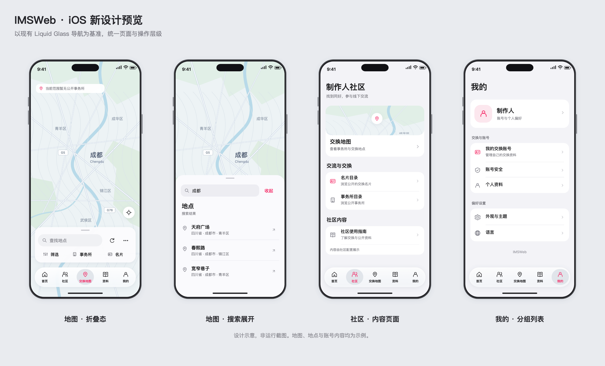

# iOS 导航基准设计预览

本组预览以现有底部 Liquid Glass 导航的胶囊轮廓、选中态与品牌粉色为基准，展示浅色设计方向。图片为精确绘制的视觉方案，不是运行截图，也不代表已完成整体 App 改造。地图、地点、账号和社区内容均为示例。

## 页面与材质

底部导航保留主要玻璃表面，内容使用浅色背景、系统式文字层级和分组列表。粉色用于选中项及关键操作，普通文字和辅助图标使用语义灰色。导航与内容之间保留清楚的间距，搜索展开时让内容面板占用底部空间。

地图折叠态使用紧凑的白色工具区，包含胶囊搜索入口、可见刷新、更多，以及筛选、事务所和名片。工具按钮采用平面排布。地图反馈只出现一次，定位按钮位于工具区上方的净空中。

搜索展开态使用白色列表面板、清楚的地点名称与次级地址。社区页展示内容入口与分组行；个人页展示账号和偏好分组。各页延续同一套导航、间距、字重和图标尺度。

地图、搜索结果和选点摘要不显示独立来源页脚。用户从现有“更多”进入“地图数据来源” Dialog，查看完整底图许可与地点搜索署名；本组示意图不新增来源 Dialog，也不证明运行时交互。

## 独立高清图

- [地图折叠态](./01-map.png)
- [搜索展开态](./02-search.png)
- [社区内容页](./03-community.png)
- [个人分组页](./04-profile.png)

每张独立图为 1120×2160 PNG，另附 SVG 原稿。总览为 3200×1940 PNG。方案审阅后，仍需在真实 UIKit 中验证玻璃材质、动态字号、主题、减少透明度、触控与键盘行为；图片不提供这些运行证据。

官方设计参考：[Apple Liquid Glass](https://developer.apple.com/documentation/technologyoverviews/liquid-glass)。本方案根据产品已有导航确定具体层级与材质，并未声称经过 Apple 审核。
