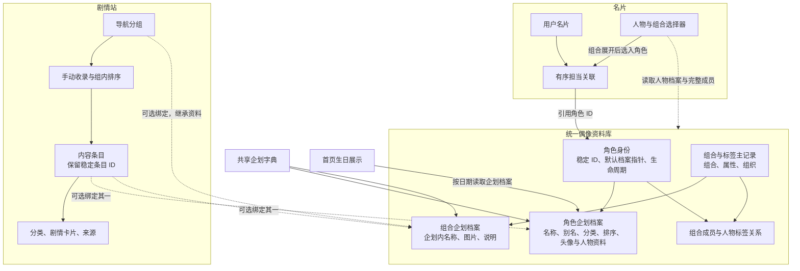

# 统一偶像资料库与名片、Wiki 引用架构

> 文档类型：架构
> 状态：Decision
> 权威来源：本文的目标约束；现有实现以 `apps/api/migrations/postgresql/`、`apps/api/src/ports/repositories/`、`packages/contracts/src/fudaba/characters.ts` 和 `packages/contracts/src/wiki.ts` 为准

本文规定目标架构、实施约束与兼容边界，当前范围见下节。实际数据库结构、HTTP 契约和运行行为
以 migration、contracts 与运行时代码为准。当前 Wiki 行为见 [Wiki 管理架构](wiki-management.md)。

## 实施与兼容边界

核心表由增量 migration 演进为企划、角色、组合、企划档案、Wiki 条目与导航；共享企划的
Wiki 配置归 `wiki_project_settings`。旧目录名称保留为数据库兼容投影，既有 StoryRepository
的兼容字段和部分剧情外键词汇仍保留；不能据此维护第二套主数据。绑定展示通过同一档案读取，
旧 Wiki 写入口不能覆盖已绑定资料。管理接口由 `domains/admin/catalog/` 提供。

公开页面、交互、路径和 HTTP 请求／响应契约保持现状。这里的项目／分组新 wire 命名仅用于
管理能力，公开读取继续投影为原有 `agencies`、`units`、`idolId` 等语义。首页生日通过公开生日
投影读取角色档案，日历和今日提示共用请求，保留样式；CG 配音筛选仍使用原有事实源。

`apps/api/scripts/migration/catalog-facts.js` 可把仓库已有生日与明确的配音状态导入本地隔离副本，
默认只读盘点，显式 `--apply` 才写入。工具保留手工资料、报告歧义与冲突，不把名单缺项当成
未配音。原生日 JSON 保留给本地导入与回放使用，生产首页不再导入它。

生日投影只展示未停用、非兜底且分类为偶像、月日完整有效的档案。同一身份只展示一次，优先
选择符合条件的默认档案，否则选按企划与档案顺序的第一份有效档案，不混合不同档案的字段。
收录数量来自实际结果；2 月 29 日仅在闰年日历中出现，不在平年补造庆生日。

## 适用范围与目标

统一偶像资料库拥有角色身份、企划档案、组合及人物标签关系。它从现有名片角色、组合目录演进，
保留角色与组合的稳定 ID，并吸收经过核对的 Wiki 人物资料。名片、Wiki 和生日展示消费同一个
资料库，各自保留业务数据和展示规则。

各模块继续共用 PostgreSQL；物理连接与事务规则见[数据库架构](database.md)。本设计不引入跨库
同步或两套可独立写入的人物目录。

## 表与字段的目标命名

表名使用所属模块前缀与复数实体名，列名使用 snake_case。`project` 表示企划，`character` 表示
人物身份，`group` 表示组合或人物标签，`entry` 表示 Wiki 内容条目，`navigation_group` 表示
Wiki 导航分组。物理数据库名称不随领域整理而改变，也不以复制数据到另一套物理库实现改名。

共享的现有 `agencies` 字典承担企划／系列归档职责，目标名为 `projects`。真实用户事务所仍归
现有名片事务所模块；不能将用户事务所、虚构组织、企划字典统一替换为同一种实体。字典现有 ID、
代码及选择器占位项的稳定标识继续保留。

| 现有结构 | 目标结构 | 变更性质 |
| --- | --- | --- |
| `agencies` | `projects` | 共享企划字典改名，Wiki 专属配置另行拆出 |
| `namecard_characters` | `catalog_characters` | 保留角色 ID，移交统一资料库维护 |
| 无对应表 | `catalog_character_project_profiles` | 新增多企划档案，承接原主企划和 Wiki 资料 |
| `namecard_units` | `catalog_groups` | 保留 ID，增加组合、属性、组织等类型 |
| `namecard_unit_agencies` | `catalog_group_project_profiles` | 关联表演进为有稳定 ID、图片与资料的企划档案 |
| `namecard_unit_members` | `catalog_group_members` | 保留完整成员关系与顺序 |
| `idols` | `wiki_entries` | 保留 Wiki 条目 ID 和剧情关系 |
| `wiki_groups` | `wiki_navigation_groups` | 明确导航职责，保留手动组织能力 |
| `wiki_group_members` | `wiki_navigation_group_entries` | 保留导航收录与排序 |
| `wiki_idol_categories` | `wiki_entry_categories` | 内容条目与剧情分类关系改名 |
| `agencies` 内 Wiki 配置 | `wiki_project_settings` | 按职责拆分，不是整表改名 |

`catalog_groups` 是本方案组合／标签主记录的统一名称；正式表演进时不并行维护一张同义的
`catalog_units`。剧情卡片、来源、封面等已有名称继续使用，相关企划和条目外键同步改名。
多语言名称、分类、版本与排序沿用现有字段约定，不为改名统一而改变其含义。

| 现有或先前提议的字段 | 目标字段或归属 | 适用范围 |
| --- | --- | --- |
| `agency_id` | `project_id` | 引用共享企划字典的关系，包括剧情卡片、来源和共享封面 |
| 角色主表原 `agency_id` | 默认企划档案及 `default_profile_id` | 主归属能力转为默认档案，不能仅改名后继续限制单企划 |
| `unit_id` | `group_id` | 组合／标签目录成员及企划档案 |
| `idol_id` | `entry_id` | 活动 Wiki 导航、分类关联、剧情卡片中的内容条目外键 |
| 导航收录表 `group_id` | `navigation_group_id` | 避免与资料库组合／标签的 `group_id` 混淆 |
| Wiki 条目 `folder_name` | `storage_slug` | 仅改字段名，既有值和生成媒体路径的规则保留 |
| Wiki 条目 `name_cn`、`avatar_*` | `local_name_cn`、`local_image_*` | 独立条目本地展示；绑定后的主数据引用分别落在企划档案 |
| Wiki 条目 `color` | `local_accent_color` | 独立条目的颜色；人物代表色导入角色企划档案 |
| Wiki 条目 `wiki_enabled` | `is_visible` | 内容条目公开可见性 |
| 企划 `wiki_enabled` | `wiki_project_settings.is_enabled` | Wiki 功能开关，与人物是否可选择分别维护 |
| 人物档案绑定 | `character_profile_id` | 指向 `catalog_character_project_profiles` |
| 组合档案绑定 | `group_profile_id` | 指向 `catalog_group_project_profiles` |

人物头像字段继续使用 `avatar_*`，组合档案图片使用 `image_*`；Wiki 导航的独立名称、图标及
颜色也明确为本地资料，绑定后读取组合档案。各处媒体版本均随同一语义前缀命名。`text_color`
保留页面文字颜色含义，不能一并导入人物代表色。`wiki_url` 必须先检查用途，再决定归入人物
资料链接或 Wiki 的兼容定位，不执行无条件字段合并。

名片担当和认领关联中的 `character_id` 及 `display_order` 继续使用，不改为 Wiki 条目或企划
档案引用。名片自身、事务所、账号、审核和存档结构不因目录移交而批量改前缀。现有以
`series_code` 表达系列归属的关系可继续使用该名称，其外键改为引用 `projects.code`。

### SQL、契约与兼容标识

SQL 重命名与 HTTP 契约升级分别制定兼容策略。新管理目录契约使用 `projects`、`projectId`、
`groups`、`groupId`；Wiki 使用 `entryId` 与 `navigationGroupId`，名片
`favoriteCharacterIds` 保留。公开响应和请求保持原契约，经适配层映射到同一个资料库；JSON、参数名、
缓存与旧客户端不会由数据库重命名自动更新。HTTP 格式的最终权威仍是 contracts。

角色、组合、企划和条目 ID、既有业务代码、对象逻辑键、来源的 `legacy_table`／`legacy_id`
不因改名变化。历史剧情证据表保留原列名；公开旧链接和旧媒体路径需在兼容读取与回读测试中
覆盖，不能全仓替换 `idol` 或 `agency` 字符串。人物分类和 Wiki 条目类型中的 `idol` 仍是
有效业务取值。

新增 migration 显式处理表、列、外键、唯一约束、独立索引与序列名称，控制标识符长度并保留
序列值。PostgreSQL 的依赖跟随不替代应用 SQL、约束名错误映射、运维脚本和测试的更新。
已执行 migration 和其 checksum 不改写。仓库的
[`0021_backoffice_persistence_names.sql`](../../apps/api/migrations/postgresql/0021_backoffice_persistence_names.sql)
提供显式改名及兼容视图的先例，但新增企划档案还需要数据回填与职责切换，不能只执行 `RENAME`。

应用 schema 最低版本门禁、预览同步的表清单和依赖顺序、导入导出、迁移对账与 SQL 测试必须
与新结构一起更新。涉及表改名的部署应明确旧应用的兼容窗口及 DDL 锁预算；旧读视图仅作兼容
投影，不成为另一套主数据或绕过企划档案规则的旧写入口。

## 数据来源与归属

| 现有来源 | 可用于完善资料库的数据 | 处理约束 |
| --- | --- | --- |
| 名片角色目录 | 稳定 ID、中日英名称、别名、人物分类、主归属企划、排序与生命周期 | 作为现有角色身份的起点，保留已有引用 |
| 名片组合目录 | 稳定组合 ID、多语言名称、别名、关联企划、完整成员及成员顺序 | 保留跨主企划成员关系 |
| Wiki 人物条目 | 企划内展示名、头像、完整构图、媒体版本、代表色 | 通过明确映射导入对应角色企划档案 |
| Wiki 栏目或组合条目 | 经核对的组合资料、图标、属性或组织标签 | 专题与导航栏目仍归 Wiki；旧展示名单不覆盖完整成员 |
| 首页生日内容 | 生日月日、名称、企划与颜色候选 | 名称仅供匹配；关联稳定身份后导入，颜色冲突需要处理 |
| Wiki 配音状态名单 | 已明确记录的已配音状态 | 不推断声优姓名；未出现在名单中不等于未配音 |

用户名片中的制作人姓名、简介、团体名、封面、设计署名、作品强调色，以及账号头像和个人简介，
继续归名片或账号模块所有。用户填写的团体名不能直接转换为组合记录。

## 目标关系

图中名称表达逻辑职责，最终表结构由增量 migration 定义。

### 角色身份与企划档案

后台统一入口称为「角色档案」。名片担当保存角色 ID，剧情人物通过内容条目的企划档案外键
关联角色，展示时读取共用档案。剧情工作台可直接选择角色档案，复用已有内容条目或事务创建
关联条目，不改变历史内容页、卡片和来源 ID。已有剧情后禁止解除或改绑角色；同名独立内容页
要求人工明确关联。主线、活动等专题保持业务条目，卡名、封面、来源等剧情内容仍由剧情维护。

角色主记录只代表稳定身份，保留 ID、默认档案指针、生命周期和审计信息，不保存人物业务资料。
多语言名称、别名、分类、兜底标记和排序与其他人物资料统一存入企划档案。一个角色可拥有多个企划
档案，同一角色在同一企划内只有一份有效档案。默认档案承接原来的主归属企划；角色在其他企划
出现时增加档案，不要求更换其角色 ID。

人物企划档案持有完整名称、头像与构图、代表色、生日、简介和外部资料引用。中文名必填，不再
从身份表回退。新增其他企划档案可用默认档案预填，保存后分别维护；图片未配置时使用占位展示。
默认
档案必须属于该角色，且不能在仍为默认时被删除。

不同作品、世界观或版本的同名人物不能仅凭中日文名称合并。现有独立身份先保留；确认是同一
身份且确需合并时，必须单独处理全部关联和兼容标识。本设计不要求先合并现有角色才能增加档案。

现有兜底选项需要保留其 ID 与选择能力，并明确标为选择器占位记录，不为其伪造生日、人物简介
或组合成员，也不能自动绑定为 Wiki 的实际人物。

### 人物资料的扩充

| 能力 | 目标语义 |
| --- | --- |
| 多语言名称与别名 | 保留现有 CN、JA、EN 与原始别名内容；允许企划内展示名差异，避免有损拆分别名文本 |
| 企划关系 | 支持多企划档案与明确的默认档案；按参与企划筛选人物 |
| 头像与构图 | 保存媒体引用、适配方式、焦点、缩放、旋转和独立媒体版本 |
| 人物代表色 | 与企划颜色、Wiki 文字颜色、名片作品强调色分别维护 |
| 生日 | 可空的月日数据，按真实日历规则校验；不补造出生年份，明确闰日展示规则 |
| 简介和资料链接 | 保存人物资料；逐项核对旧 `wiki_url` 指向的是人物资料还是本站内容 |
| 配音状态与 CV | 区分未知、已配音、明确未配音；企划档案以可空 `cv_name` 保存声优署名，管理契约为 `cvName`；不能用 CV 为空推断未配音 |
| 后续结构化属性 | 身高、血型等在确认业务语义与来源后增加明确字段或附表；不从已有数据猜测缺失值 |

企划可能影响人物设定，生日、配音和其他设定资料首先归企划档案，不自动在不同企划间复制。
同一资料在多个页面使用时读取同一档案，不再维护前端静态副本。

### 组合与标签

组合、属性分组和组织是有稳定 ID、类型和企划档案的资料对象，通过有序多对多关系关联角色。
继承现有组合目录的多企划能力，不增加“成员主企划必须与组合企划相同”的限制。

组合成员描述完整人物关系；Wiki 导航收录描述内容页展示，两者分别维护。名片选组时读取完整
的可选择成员，不读取 Wiki 导航的页面名单。成员数量或顺序变化不会回写已经保存的名片担当。

## 名片如何引用

名片继续保存有序角色 ID 集合，维持现有多担当能力、去重规则与契约上限。通过组合选择加入
担当时展开为角色 ID，不将组合 ID 存入角色关联，也不在读取旧名片时重新展开组合。

名片默认从角色的默认企划档案读取头像、颜色与展示资料，名称遵循一致的语言回退规则。选择器
按全部参与企划筛选角色，同一角色出现于多个企划时仍按角色 ID 去重。只有明确需要名片固定
某个企划形象时，才增加关联到该角色企划档案的可选展示偏好；不得用多个角色 ID 模拟形象差异。

选择器读取精简目录，包括检索名称、企划、分类、标签、可选择成员及展示摘要；人物详情另按需
读取，不把全部简介和扩展资料塞入首次选择器请求。名片展示按已选 ID 批量解析，避免逐人物查询。
目录需要版本或 HTTP 校验与重新验证机制，替代页面生命周期内永久复用的请求结果。
名片目录、担当展示及认领回读从默认企划档案取得名称、分类、别名和所属企划，保存的担当仍是
稳定角色 ID。切换默认档案采用身份版本校验，会更新已有名片的动态展示，不改写担当关系。
档案保存和默认切换后清除名片选择目录及页面共享请求缓存，避免后台修改后仍使用旧候选资料。

既有名片和认领记录中的关系必须保留；待审核版本载荷中的角色 ID 同样属于引用。人物停用后，
旧名片仍可展示并允许原样保留或移除该担当，新选择不能加入停用人物。服务端分别校验保留项与
新增项，不能让未变更的历史担当阻止保存其他字段。

组合展开超过上限时必须明确提示并让用户决定收录范围，不得无提示截断。目录更新与提交之间
发生人物停用或成员变化时，服务端按实际提交的角色 ID 校验，不隐式增删担当。

## Wiki 如何引用

内容条目可绑定一个同企划的角色档案、一个同企划的组合档案，或保持独立。数据库保护绑定目标
存在、企划一致及两种绑定互斥。同一企划内，同一档案最多绑定一个有效内容条目。

绑定条目读取主数据名称、头像、构图和人物代表色；独立条目维护自己的资料。Wiki 的文字颜色、
页面布局、可见性、排序、目录标识和剧情内容继续由 Wiki 维护。页面类型不能作为人物身份映射
的唯一依据。稳定条目 ID、已有素材定位不因绑定或改名变化；旧名称地址需有明确的兼容定位。

公开剧情查询继续按企划与名称定位。数据库在事务提交时校验继承后的有效名称，并保护其他条目
已有的本地定位名；资料改名或重新绑定不能产生歧义或占用原地址。检查按企划串行化，冲突时回滚
整次资料写入。管理端资料变更沿用 Wiki 的客户端缓存失效来源。

导航分组继续使用自己的手动收录关系，可选绑定组合档案以继承名称和图片。绑定不自动替换
收录名单或顺序；纯剧情专题和目录标题保持独立。按组合成员动态生成入口是另一个显式选项，
不得在迁移时默认开启。

解除绑定时需显式生成独立展示资料并建立正确的媒体引用；删除 Wiki 条目或导航不能删除角色、
组合、名片担当或主数据媒体。共享企划字典中的 Wiki 开关、布局版本等配置应逐步回归 Wiki。

## 主数据维护与媒体生命周期

统一资料库只有一个维护入口和写入责任。名片与 Wiki 管理页可跳转至该入口，不能各自更新一份
人物资料。现有名片目录接口可在兼容期保留为统一目录的读取投影；不能因此产生第二套人物写源。
后台「偶像管理」按企划直接展示完整人物和组合档案，身份、成员关系维护也集中于此；原名片目录
地址只保留兼容跳转。名片与 Wiki 创建自己的业务记录或内容实例，通过稳定身份／企划档案关联。
Wiki 仍可选择独立维护，关联后可定位来源档案。编辑者查看完整档案不代表获得主数据写权限。
共享 HTTP 格式仍由 [contracts](../../packages/contracts/README.md) 定义，域内数据库记录不充当
跨 workspace 契约。

资料与媒体分别使用乐观锁。资料库拥有角色、组合头像的上传、替换和删除责任，Wiki 只管理独立
条目图片与剧情素材。旧对象逻辑键可以保留，但必须更新业务引用和清理权限，接入现有
[对象存储状态机](object-storage.md)。文字颜色等页面表现不参与人物头像清理。

替换图片后只回收已无有效引用的旧对象；与解绑、恢复、停用并发时也必须保护引用。旧 Wiki
上传和删除入口在绑定对象上应拒绝操作或转交同一资料库写入流程，不得绕过主数据版本与清理规则。

绑定期间的本地展示备份不计作有效媒体引用；解绑时在同一事务中复制当前档案图片与构图，再清除
绑定。补偿删除在执行时重新检查引用。S3 使用既有公开对象机制，本地文件存储把 `catalog/`
归入上传根；管理图片预览可回退到鉴权后的管理读取，不增加公开 delivery 路由。

停用对象不再接受新选择，但已有名片和 Wiki 引用继续可解析，不隐式下线内容。硬删除必须受
全部引用保护，软删除也需由应用规则保护历史显示。默认档案与仍被绑定的档案不能被直接移除。
后台迁移不能隐式扩大既有维护角色的权限。

组合新增企划档案同时推进组合版本，旧版组合编辑器不能用过期的企划名单删除新档案。关闭档案
管理后刷新原列表，使后续基础资料编辑使用当前版本。

## 导入、切换与验收约束

迭代以线上预览库的一致快照为基准，先在本地隔离副本演练，再做预览环境联调。正式库升级与
迁移测试在预览方案稳定后独立进行；预览库不能覆盖正式库。快照标识、数量、散列和映射证据
进入被忽略的私有 manifest，不写入长期架构文档。

导入必须遵循以下约束：

1. 以现有角色与组合 ID 建立初始资料库，先为原主企划创建默认档案。
2. 为 Wiki 人物、组合和静态资料生成明确的来源到目标映射；名称只用于候选检索。冲突、疑似
   重复和无法匹配的资料分别列出，不自动合并或静默丢弃。
3. 已存在于角色目录的资料保留，Wiki 补充对应企划的头像和展示资料；不同来源对同一字段有
   分歧时，必须记录取值依据。未确认的人物条目可继续独立，资料库缺失的人物经确认后新建。
4. 导入任务可重复执行并使用来源标识去重，检查来源及目标版本；不能覆盖导入后人工修改的资料。
5. 在保留旧标识与引用的前提下切换名片读取、Wiki 绑定和主数据维护责任；图片清理与写入入口
   必须一起切换。旧字段和兼容结构在后续独立变更中清理。
6. 出生日期与配音状态的页面在数据库内容完整、可回读后切换，切换完成才移除对应静态事实源。

验收通过真实 PostgreSQL、对象存储与应用读取验证下列不变量：

| 范围 | 必须验证 |
| --- | --- |
| 身份与引用 | 原角色、组合、名片担当、认领、待审核版本引用均可解析，顺序和去重语义不变 |
| 多企划 | 同一人物跨企划使用不同资料；同名不同身份不误合并，跨主企划组合仍可选择 |
| 名片 | 多担当保存、组合展开、默认形象、资料更新、停用担当保留、超限提示与目录刷新 |
| Wiki | 绑定与独立条目均可用，导航名单与顺序保持，剧情卡片和来源仍可达，旧地址可定位 |
| 人物资料 | 生日与配音来源可追溯，未知值不伪造，不同企划数据不会相互覆盖 |
| 媒体与并发 | 改图、解绑、删除、冲突和恢复不会误删共享对象，公开与后台构图一致 |
| 回滚兼容 | 清理旧结构前证明旧版可读；不能假设写入新资料后只回退代码即可恢复旧行为 |

具体执行流程应遵循 [AI 开发环境](../development/ai-environment.md) 与目标环境的迁移发布规则。
