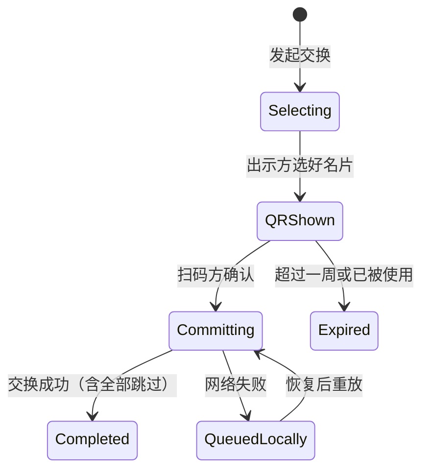

# 名片交换系统设计

> 文档类型：架构方案与执行计划
> 状态：Decision
> 权威来源：本文件；实现以 `packages/contracts/src/namecards.ts`、`apps/api/src/domains/community/namecards` 为准

名片交换取代现有的单向收藏能力（该能力从未上线，无需迁移数据）。交换只改变「谁的名片在谁的名片册里」，
不改变名片归属，两个方向的数量可以不对等，一方可以一张名片都不提供。

## 1. 术语与基本规则

| 术语 | 定义 |
| --- | --- |
| 名片册 | 某个账号已经交换得到的名片集合。取代原先的收藏夹，是唯一的「我拥有的他人名片」来源 |
| 可用名片 | 整卡 `publication_status='published'`。版本审核状态不影响整卡的可交换性 |
| 提供方 | 本轮交换中把自己名片交给对方的人 |
| 目标方 | 本轮交换中被取走名片的人 |
| 跳过 | 因为重复或状态变化而不写入名片册，但本轮交换仍算成功 |

固定规则：

1. 交换模式 `none`（不可交换）只阻止他人**主动向这张名片发起**交换；持有者仍可以把这张名片用于交换。
2. 名片可见性（`visible`）只影响名片墙与个人主页的展示，不影响持有者主动分享。
3. `auto`（自动确认）的名片在交换流程中不产生任何通知。
4. `manual`（手动确认）的名片被他人申请交换时，持有者收到通知并决定是否同意，申请者随后收到结果通知。
5. 整卡 `locked` 与 `hidden` 的名片不会出现在持有者的「选择用于交换的名片」列表里，因此不能作为提供方。
11. 团体名片（`is_group_card=true`）的交换模式固定为 `auto`：数据库 CHECK、服务端与编辑器三处同时约束，
    勾选或取消该标记本身要经过版本复审。
6. 整卡 `locked` 的名片不出现在已交换方的名片册里；整卡 `hidden`（持有者删除）的名片仍然出现在名片册里。
7. 无主名片不参与交换；`withdrawn` 状态不使用，不在设计范围内。
8. 已经在我名片册里的名片不能被再次交换；对方已经拥有的名片不会被我再次送出。命中时后台自动跳过。
9. 名片归属（`owner_account_id`）在交换前后不变。
10. 每张名片都固定拥有一个交换链接，不存在「撤销」；链接的行为由名片状态与交换模式实时决定。

## 2. 四种入口

| 入口 | 链接形态 | 有效期 | 目标卡范围 | 提供卡范围 |
| --- | --- | --- | --- | --- |
| 主动分享 | `/exchange/card/<slug>` | 长期，随名片状态失效 | 该名片 | 访问者的可用名片 |
| 发起申请 | 无链接，针对墙/主页上的名片 | 即时 | 该名片 | 访问者的可用名片 |
| 快速交换 | `/exchange/<uid 或 page_slug>` | 长期，随列表变化 | 该账号的快速交换列表 | 访问者的可用名片 |
| 扫码交换 | 一次性二维码 | 一周或直到交换成功 | 出示方本轮已选名片 | 扫码方本轮已选或现场选择 |

### 2.1 主动分享

每张名片都有一个长期链接与可下载二维码，链接始终存在，响应随状态变化：

| 名片状态 | 打开链接的结果 |
| --- | --- |
| `published` 且模式为 `auto` / `manual` | 正常进入交换流程 |
| `published` 且模式为 `none` | 「此名片已不接受交换」 |
| `locked` / `hidden` | 「此名片暂不可交换」，不解释原因 |

把名片改成 `none` 之前必须提醒持有者并二次确认，因为这会立刻让已经发出去的链接失效。

### 2.2 发起申请

在名片墙或个人主页对某张名片发起交换，后续流程与主动分享一致，区别只是不需要链接，
服务端按名片编号定位目标。`none` 的名片不显示申请入口。

### 2.3 快速交换

账号维护一个快速交换名片列表，并生成固定链接（uid 或自定义 slug，不使用 token，因为内容会变化）。

- 只有 `auto` 名片可以进入列表；改成其它交换模式时自动移出。
- 名片变为 `locked` 或 `hidden` 时自动移出。
- 列表内名片被取走的流程与主动分享一致。
- 任何需要「选择名片参与交换」的场合，都会自动勾选该账号快速交换列表中的名片。

### 2.4 扫码交换

线下面对面：双方各自发起交换并选好本轮名片后，由至少选择了一张名片的一方出示二维码，另一方扫码。

- 扫码方在应用内（专用扫码界面）扫码：选择已完成，确认后直接开始交换。
- 扫码方用其它应用扫码并打开网页：后续流程与快速交换相同，现场选择名片。
- 该模式不发送通知，且无论名片交换模式如何都自动通过。
- 每个二维码仅可使用一次，以交换是否成功为准；因重复被跳过的同样算成功。
- 二维码有效期一周，或直到该轮交换成功为止，两者先到者生效。
- 网络失败时交换记录落本地队列，恢复后重放。



## 3. 数据模型

新增迁移（时间戳按提交日生成），全部位于 `apps/api/migrations/postgresql`。

### 3.1 `namecard_exchanges`

一次交换的事实记录，也是幂等与离线的锚点。

| 列 | 类型 | 说明 |
| --- | --- | --- |
| `id` | uuid PK | |
| `client_exchange_id` | text UNIQUE | 客户端生成的幂等键，离线重放返回同一条记录 |
| `source` | text | `card-share` / `card-request` / `quick` / `scan` |
| `status` | text | `pending` / `completed` / `declined` / `expired` |
| `initiator_account_id` | text | 发起方（访问者 / 扫码方） |
| `target_account_id` | text | 目标方（链接持有者 / 出示方） |
| `target_card_numbers` | bigint[] | 本轮取走的名片编号（快照） |
| `initiator_card_numbers` | bigint[] | 本轮给出的名片编号（快照） |
| `skipped` | jsonb | 被跳过的名片与原因，供前端解释 |
| `created_at` / `resolved_at` | timestamptz | |

约束：`initiator_account_id <> target_account_id`。全部被跳过时两个数组都可以为空。

### 3.2 `namecard_collection_entries`

名片册。取代 `fudaba_card_favorites`。没有删除操作，只有「默认不展示」开关。

| 列 | 类型 | 说明 |
| --- | --- | --- |
| `id` | uuid PK | |
| `collector_account_id` | text | 名片册归属账号 |
| `card_number` | bigint | 名片编号，卡片被物理删除后仍然可读 |
| `card_id` | text NULL | `ON DELETE SET NULL`，卡片还在时用于联表读最新内容 |
| `exchange_id` | uuid | 来自哪次交换 |
| `obtained_at` | timestamptz | |
| `hidden_at` | timestamptz NULL | 持有者手动选择「默认不展示」的时间 |
| `snapshot` | jsonb | 交换时的渲染快照，卡片不存在时兜底 |

唯一键 `(collector_account_id, card_number)`。索引 `(collector_account_id, obtained_at DESC)`。
`hidden_at` 只影响列表展示，不影响「已拥有」的判定。

### 3.3 `namecard_exchange_links`

每张名片一条，卡片创建时写入，历史卡片在迁移里回填。

| 列 | 类型 | 说明 |
| --- | --- | --- |
| `card_id` | text PK | `ON DELETE CASCADE` |
| `slug` | text UNIQUE | 12 位随机串，生成后不再变化 |
| `created_at` | timestamptz | |

链接是否可用由名片状态实时计算，不写入本表。

### 3.4 `namecard_quick_exchange_cards`

快速交换列表。

| 列 | 类型 | 说明 |
| --- | --- | --- |
| `account_id` | text | |
| `card_id` | text | |
| `added_at` | timestamptz | |

主键 `(account_id, card_id)`。写入时校验 `published` + `auto`；读取时再次过滤，避免状态迁移期间漏网。

### 3.5 `namecard_scan_sessions`

扫码二维码。

| 列 | 类型 | 说明 |
| --- | --- | --- |
| `id` | uuid PK | |
| `token_hash` | text UNIQUE | 明文只在生成时返回，库存 sha256 |
| `account_id` | text | 出示方 |
| `card_numbers` | bigint[] | 出示方本轮选择，至少一张 |
| `created_at` / `expires_at` | timestamptz | 生成时 `+7 天` |
| `consumed_at` / `consumed_by_exchange_id` | | 一次性消费 |

### 3.6 通知

在 `NAMECARD_NOTIFICATION_KINDS` 增加：

- `card-exchange-requested`：目标名片为 `manual`，通知持有者有待确认的交换。
- `card-exchange-accepted`：持有者同意后通知申请者。
- `card-exchange-declined`：持有者拒绝后通知申请者。

`auto` 与扫码模式不产生任何通知。

## 4. 交换执行

服务端在单个事务内完成，入参统一为
`{ clientExchangeId, source, actor, target, targetCardNumbers[], giveCardNumbers[] }`。

1. **幂等**：按 `client_exchange_id` 查已有记录，命中直接返回。
2. **解析目标卡集合**：单卡入口是那一张；快速交换是目标账号当前列表；扫码是会话中的 `card_numbers`。
3. **过滤目标卡**：必须属于目标账号、`published`、未 `locked`；除扫码外还要求 `exchange_mode <> 'none'`。
4. **过滤给出卡**：必须属于发起方、`published`、未 `locked`。
5. **跳过**：目标卡已在发起方名片册、给出卡已在目标方名片册，都记入 `skipped` 且不写入。
6. **判定确认**：除扫码外，目标卡中存在 `manual` → `pending`；其余 → `completed`。
7. **写入**：`completed` 时双向插入名片册条目；`pending` 时只写通知，等待目标方接受。
8. **扫码语义**：无论模式一律 `completed` 且不发通知；全部被跳过也返回成功，并消费二维码。

确认与拒绝：`POST /exchanges/:id/accept` 把 `pending` 转 `completed` 并写入双向条目；
`decline` 转 `declined`；超时转 `expired`。两种结果都通知申请者。

## 5. 名片册读取

```sql
SELECT entry.*, card.publication_status
FROM namecard_collection_entries entry
LEFT JOIN fudaba_cards card ON card.id = entry.card_id
WHERE entry.collector_account_id = ?
  AND entry.hidden_at IS NULL
  AND (card.id IS NULL OR card.publication_status <> 'locked')
ORDER BY entry.obtained_at DESC
```

- `locked` 被过滤；解锁后条目自动重新出现。
- `hidden` 保留展示，界面标记为已隐藏。
- 卡片行不存在时用 `snapshot` 渲染。
- 内容实时读取，对方更新名片后名片册随之更新。

## 6. 链接与二维码

| 场景 | 路径 | 生成方式 |
| --- | --- | --- |
| 单卡分享 | `/exchange/card/<slug>` | 卡片创建时生成，历史卡片由迁移回填 |
| 快速交换 | `/exchange/<uid 或 page_slug>` | 复用账号公开标识，与 `/user/<handle>` 同一套解析 |
| 扫码 | `/exchange/scan/<token>` | 32 位十六进制随机串，库存 sha256 |

二维码在客户端用 canvas 绘制，可下载为 PNG，服务端只提供 URL。二维码内容始终是 https 链接；
应用内扫码由内置扫码器读取，不依赖系统跳转。

打开链接时的判定顺序：名片/账号是否存在 → 状态是否允许（`none`、`locked`/`hidden` 分别给出对应文案，
其中 `locked`/`hidden` 不解释原因）→ 是否本人（提示这是自己的链接）。

### 6.1 分享页的 OGP

Web 目前是纯 SPA（没有 `entry.server.tsx`），`__spa-fallback.html` 是静态文件，因此动态路由拿不到
服务端数据。交换分享页要被社交平台正确预览，需要：

1. `__spa-fallback.html` 改成带占位符的模板（`<!--og-meta-->`）。
2. API 在返回 `/exchange/*` 的 HTML 时按路径取数据并注入 `og:title`、`og:description`、
   `og:image`、`og:type`、`twitter:card`，再交给 SPA 启动。
3. 图片用名片正面的 600×400 缩略图；快速交换用列表首张，扫码页用出示方首张。
4. 注入结果按 URL 缓存一分钟，避免每次 HTML 请求都查库。

## 7. 离线与重放

- 提交前客户端生成 `clientExchangeId`（uuid）并落本地队列（WebView 内使用 IndexedDB）。
- 网络失败时保留 `{ clientExchangeId, source, target, targetCardNumbers, giveCardNumbers }`。
- 恢复后按顺序重放，服务端按幂等键返回同一条记录，不重复写入名片册。
- 扫码 token 只在成功时消费；重放使用同一 token 仍然有效，超过一周则提示重新扫码。

## 8. API 契约

| 方法 | 路径 | 说明 |
| --- | --- | --- |
| `GET` | `/api/community/exchange/card/:slug` | 单卡分享页数据 |
| `POST` | `/api/community/exchange/card/:slug/commit` | 提交交换 |
| `POST` | `/api/community/exchange/cards/:cardNumber/request` | 发起申请，等价于 commit |
| `GET` | `/api/community/exchange/quick/:handle` | 快速交换列表 |
| `POST` | `/api/community/exchange/quick/:handle/commit` | 提交交换 |
| `GET` / `PUT` | `/api/community/exchange/me/quick` | 读取/保存快速交换列表 |
| `POST` | `/api/community/exchange/scan/sessions` | 出示方创建二维码会话 |
| `POST` | `/api/community/exchange/scan/sessions/:token/commit` | 扫码方提交 |
| `GET` | `/api/community/exchange/me/collection` | 名片册 |
| `PUT` | `/api/community/exchange/me/collection/:cardNumber` | 切换「默认不展示」 |
| `GET` | `/api/community/exchange/me/exchanges` | 交换历史（含待确认） |
| `POST` | `/api/community/exchange/exchanges/:id/accept` / `decline` | 手动确认 |

`card` 与 `quick` 的 GET 返回里带 `targetMissingCount`，供客户端在「我有对方没有的名片但一张都没选」时
触发二次确认。

## 9. 退役清单

- `fudaba_card_favorites` 表、`setCardInteraction` 的 favorite 分支、卡片投影里的 `favorites` 计数、
  `/me/favorites` 端点、`account/me/favorites` 页面、墙与详情窗的收藏按钮。
- `fudaba_exchange_requests` 表，以及 `fudaba_office_cards` 删除守卫里对它的 `in_use` 判断。
- 契约中 `favorites` 字段与对应 i18n 文案。

`fudaba_card_likes` 是独立的单向点赞，与交换无关，保留。

## 10. 执行顺序

1. ✅ 迁移：新增五张表、删除旧交换表、补通知 kind。
2. ✅ 契约：路径 builder、请求/响应 schema、`targetMissingCount`。
3. ✅ 仓储：`NamecardRepository` 增加交换、名片册、快速列表、扫码会话四组方法。
4. ✅ 服务端流程：执行算法 + 确认/拒绝 + 幂等 + 跳过。
5. ⏳ 前端：四条入口、名片册页、快速列表管理、二维码绘制与下载。
6. ⏳ OGP 模板注入（依赖 `__spa-fallback.html` 模板化）。
7. ⏳ 离线队列与重放（客户端 IndexedDB）。
8. 部分完成：旧交换表已退役；**收藏按决定保留到前端阶段**，届时再清 `fudaba_card_favorites`、
   `/me/favorites`、投影里的 `favorites` 计数与按钮。

## 11. 测试计划

- 规则矩阵：`none` / `locked` / `hidden` / `auto` / `manual` 在两方向上的组合。
- 跳过：已拥有、对方已拥有、全部跳过仍算成功。
- 幂等：同一 `clientExchangeId` 重复提交只落一次。
- 扫码：单次消费、超时、离线重放。
- 快速列表：模式改动与状态变化的自动移除。
- 名片册：锁定过滤、隐藏保留、手动不展示、卡片删除后快照渲染。

## 12. 已定的取值与剩余问题

已定：

- 扫码二维码有效期一周，或直到交换成功。
- 名片册没有删除，只有 `hidden_at` 的「默认不展示」。
- 每张名片固定一个交换链接，不做撤销。
- `fudaba_card_likes` 保留。
- `page_slug` 不允许纯数字：契约、错误解析器与数据库约束三处同时收紧，历史数据由迁移校验。

已定（原「建议取值」已确认）：

- **快速交换列表上限 20 张**，**单次交换提供上限 20 张**（契约常量 `NAMECARD_EXCHANGE_CARD_LIMIT`，
  数据库 CHECK 同步）。名片册是卡片网格，20 张一屏可见；上限主要防误操作并给限流一个稳定上界。
  扫码模式出示方同样受 20 限制。
- 旧 `fudaba_exchange_requests` 连同 `fudaba_office_cards` 删除守卫里的 `in_use` 判断、
  `fudaba_moderation_cases.resource_kind='exchange'` 取值与 `FUDABA_CARD_PLACEMENT_IN_USE` 错误码一并删除。
- OGP 注入本轮不做，留到前端阶段。
- 名片册快照存**对象键**，读取时经 `resolveSnapshotMedia` 换成存储签名 URL（与墙一致）。

已定（补充）：

- 快速交换链接同样返回 `targetMissingCount`，四条入口的二次确认规则一致。
- OGP 注入对全部访客生效，不做 UA 分流。
- 交换在 `pending` 期间不占用名片：同一张卡可以同时出现在多轮交换里，持有者也可以继续分享给别人；
  名片册条目按「谁收藏了哪张卡」记录，不存在排他性。

## 13. 后端实现进展（前端入场前先读）

后端（迁移 / 契约 / 仓储 / 服务端）已落地，前端尚未开始。当前代码事实：

| 层 | 位置 |
| --- | --- |
| 迁移 | `apps/api/migrations/postgresql/20261106120000_namecard_exchange_system.sql` |
| 契约 | `packages/contracts/src/namecards.ts` 的 `namecard*Exchange*` / `namecardCollection*` / `namecardScan*`，路径叶子在 `packages/contracts/src/paths.ts` 的 `exchange*Path` |
| 端口 | `apps/api/src/ports/repositories/namecards.ts` 的「名片册与交换」一节（15 个方法） |
| 仓储 | `apps/api/src/infra/db/repositories/core-repository.ts` 的 `commitExchange` / `decideExchange` / 名片册 / 快速清单 / 扫码会话 |
| 服务端 | `apps/api/src/domains/community/namecards/exchange/`（`commit.ts`、`media.ts`、`scan.ts`、`request.ts`、`handlers/`、`routes.ts`） |

路由全部挂在 **`/api/community/exchange`** 下（`app.route(communityApiPath(), namecardExchangeRoutes())`），
共 13 条：`card/:slug`（+`/commit`）、`cards/:cardNumber/request`、`quick/:handle`（+`/commit`）、
`me/quick`（GET/PUT）、`me/collection`（GET）与 `me/collection/:cardNumber`（PUT）、`me/exchanges`、
`scan/sessions`（+`/:token/commit`）、`exchanges/:id/accept|decline`。写操作统一走
`platformAuth + activePlatformMutation + platformCsrf + platformWriteRateLimit`。

实现时必须遵守的两条（都踩过）：

- **响应里的媒体地址要穿存储**：仓储给的是对象键，handler 必须经 `resolveExchangeCardMedia` /
  `resolveSnapshotMedia` 换成签名 URL，否则浏览器加载不了。参考 `public-cards/handlers/get-public-card.ts`。
- **名片册快照存键、读时解析**：`snapshot` 是交换当时那份投影的冻结副本，卡片被删后靠它渲染；
  签名 URL 会过期，所以库里存键，`me/collection` 读时再解析。

验证入口：`apps/api/tests/server/namecard-exchange.test.ts`（真库：双向入册、manual 待确认后裁决、
幂等与跳过、快速清单过滤）与 `namecard-exchange-routes.test.ts`（分享页 404/400、写接口 401、快速页 404）。
